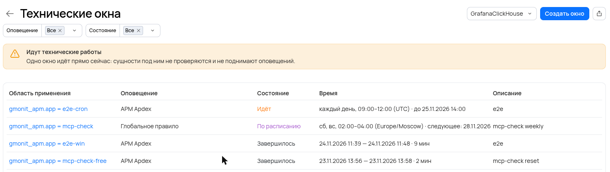
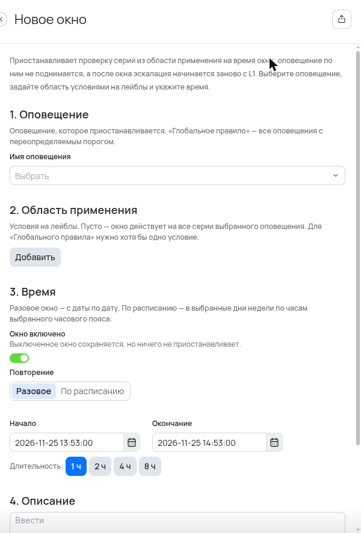
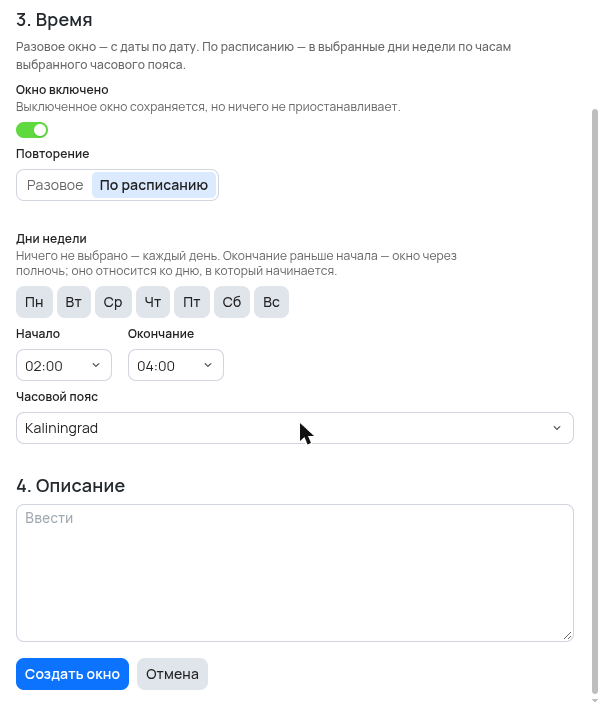
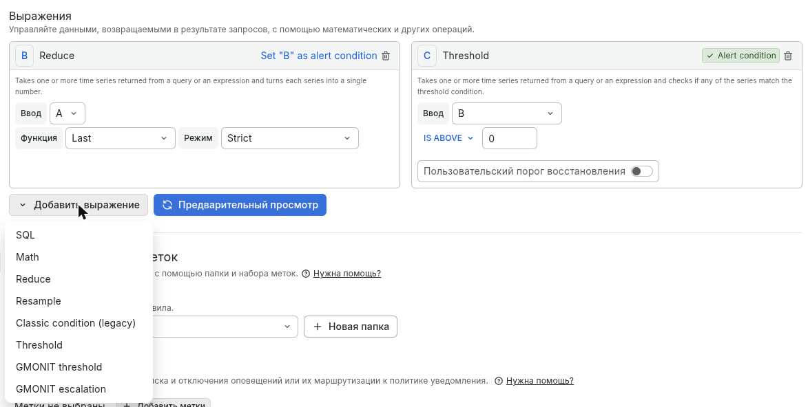
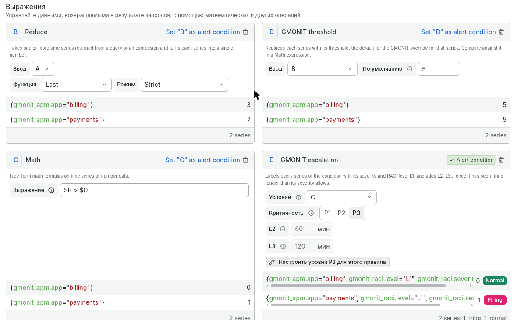

# Коробочные оповещения — Использование

## Состав коробочного пакета

Готовые правила, которые включаются вместе с пакетом. Пороги ниже — значения по умолчанию; любое из них можно [переопределить для отдельной сущности](#Переопределить-параметры-оповещения-для-сущности).

<!-- STEP_GUIDE:START Каталог правил коробочного пакета: перечень готовых правил, сгруппированный по областям мониторинга (APM, браузерный мониторинг, базы данных, инфраструктура), с указанием что отслеживает каждое правило, порогом срабатывания по умолчанию и единицей измерения. Отдельно — правила потери связи с агентом, срабатывающие при прекращении поступления данных. -->

Пакет покрывает четыре области мониторинга. Часть правил объединяет несколько связанных метрик под одним оповещением — тогда у каждой метрики свой порог по умолчанию, и переопределять их можно по отдельности.

Если не указано иное, правило срабатывает при **превышении** порога.

### Потеря связи с агентом

Эти правила следят за самим фактом поступления данных и срабатывают, когда агент перестаёт присылать метрики. Порога как такового у них нет — реагируют на отсутствие данных.

| Оповещение | Когда срабатывает |
|---|---|
| APM: нет данных от агента | Приложение перестало присылать APM-метрики |
| Database: нет данных от агента | Агент базы данных перестал присылать метрики |
| Host: нет данных от агента | Хост перестал присылать метрики |
| Container: нет данных от агента | Контейнер перестал присылать метрики |
| Storage: нет данных от агента | Агент хранилища перестал присылать метрики |

### APM

| Оповещение | Метрика | Порог | Ед. |
|---|---|---|---|
| APM Apdex | Индекс удовлетворённости; срабатывает при **падении ниже** порога | 0.5 | — |
| APM метрики | Время отклика веб-транзакций (среднее) | 5 | с |
| | Время отклика прочих транзакций (среднее) | 5 | с |
| | Ошибки веб-транзакций | 10 | % |
| | Ошибки прочих транзакций | 5 | % |
| | Внешние вызовы (среднее) | 5 | с |
| | Запросы к БД на веб-запрос | 100 | — |
| | Запросы к БД на прочую транзакцию | 100 | — |

### Браузерный мониторинг

| Оповещение | Метрика | Порог | Ед. |
|---|---|---|---|
| Browser JS-ошибки | Количество JS-ошибок | 20 | — |
| Browser события | AJAX-ошибки (количество) | 30 | — |
| | Время загрузки страницы (p75) | 3000 | мс |
| Browser Web Vitals | LCP — отрисовка крупнейшего элемента (p75) | 2500 | мс |
| | FCP — первая отрисовка контента (p75) | 1800 | мс |
| | INP — отклик на взаимодействие (p75) | 500 | мс |
| | FID — задержка первого ввода (p75) | 100 | мс |
| | CLS — сдвиг макета (p75) | 0.25 | — |

### Базы данных

| Оповещение | Метрика | Порог | Ед. |
|---|---|---|---|
| DB метрики | MySQL: подключённые потоки | 200 | — |
| | MySQL: ожидание блокировок таблиц | 5 | /с |
| | MySQL: медленные запросы | 1 | /с |
| | Postgres: пул соединений | 80 | % |
| | Postgres: блокировки | 10 | /с |
| | Postgres: взаимоблокировки | 1 | /с |
| | MSSQL: активные подключения | 200 | — |
| | MSSQL: ожидание блокировок | 10 | /с |
| | MSSQL: взаимоблокировки | 1 | /с |
| | Redis: подключённые клиенты | 5000 | — |
| | Redis: заблокированные клиенты | 5 | — |

### Инфраструктура

| Оповещение | Метрика | Порог | Ед. |
|---|---|---|---|
| Infra хостовые метрики | Загрузка CPU | 90 | % |
| | Использование памяти | 90 | % |
| | Использование swap | 50 | % |
| | Ожидание ввода-вывода CPU | 20 | % |
| | Средняя нагрузка (1 мин) | 5 | — |
| | Использование диска | 90 | % |
| Infra дисковые метрики | Использование диска по точкам монтирования | 90 | % |
| | Использование inode диска | 90 | % |
| | Загрузка дисковых операций | 80 | % |
| | Диск в режиме только для чтения (срабатывает при переходе диска в read-only) | — | — |
| Container метрики | Загрузка CPU | 80 | % |
| | Использование памяти | 85 | % |
| | Перезапуски контейнера (за интервал) | 5 | — |

<!-- STEP_GUIDE:END -->

## Просмотреть активные оповещения

<!-- STEP_GUIDE:START Просмотр сработавших оповещений пакета: где находится список, как отображается текущий уровень эскалации нарушения, какие метки и сведения сопровождают каждое оповещение. -->

Правила пакета — это обычные оповещения Grafana, поэтому их состояние видно в стандартном разделе оповещений Grafana. Каждое сработавшее правило показывает свои активные инстансы (серии).

Сработавшие оповещения по умолчанию попадают и на общий дашборд GMONIT, в список активных оповещений, так что их видно сразу при входе, без перехода в раздел оповещений Grafana.

### Уровни эскалации RACI

Дополнительно к самому факту срабатывания пакет проставляет на каждом инстансе метки эскалации по матрице RACI:

| Метка | Значения | Что означает |
|---|---|---|
| `gmonit_raci.level` | `L1`, `L2`, `L3` | Текущий уровень эскалации нарушения |
| `gmonit_raci.severity` | `P1`, `P2`, `P3` | Профиль важности, задаёт скорость эскалации |

Как читать уровни:

- **`L1`** присваивается сразу при срабатывании.
- **`L2`** появляется, когда нарушение держится близко к заданной для уровня задержке.
- **`L3`** появляется при дальнейшем сохранении нарушения.

Одно и то же нарушение отображается несколькими инстансами, по одному на каждый активный уровень. Поэтому при затяжной проблеме у правила одновременно видны инстансы с `L1`, `L2` и `L3` для одной и той же серии. Так задумано: при смене уровня предыдущие инстансы не помечаются как «разрешённые» ложно.

<!-- STEP_GUIDE:END -->

## Переопределить параметры оповещения для сущности

> Создавать и менять правила может пользователь с ролью Editor и выше, пользователь с ролью Viewer только просматривает их. Подробнее — в разделе [Права на переопределения, эскалацию и технические окна](/modules/alert-pack/setup.md#Права-на-переопределения-эскалацию-и-технические-окна).

<!-- STEP_GUIDE:START Переопределение параметров срабатывания правила для отдельной сущности: где находится страница, какие параметры доступны (порог, исключение из оповещений, условие применения), как создать, изменить и удалить переопределение. -->

Переопределения меняют параметры срабатывания правила для отдельной сущности (приложения, хоста, метрики), не трогая весь пакет. Они собраны на странице **Оповещения → Переопределения**.

На странице показана таблица существующих правил со столбцами: **Область применения** (условие), **Оповещение**, **Состояние**, **Порог**. Сверху доступны фильтры по оповещению и состоянию.

### Создать переопределение

1. Нажмите **Создать правило** в правом верхнем углу, откроется форма.

2. **Оповещение**: выберите правило, к которому применяется переопределение. В списке — коробочные и [пользовательские правила, подключённые к переопределениям](#Подключить-пользовательское-правило-к-переопределениям-и-эскалации). Вариант **Глобальное правило** применяет переопределение ко всем этим правилам.

3. **Область применения**: задайте условия на метки, чтобы ограничить переопределение конкретными сущностями. Нажмите **Добавить**, выберите метку, оператор и значения. Без условий переопределение применяется ко всем сериям правила.

4. **Переопределение**: задайте, что именно заменить.
   - **Исключить из оповещений**: переключатель, попавшие под область серии перестают порождать оповещения.
   - **Порог оповещения**: числовое значение порога срабатывания. Под полем показан порог по умолчанию для выбранной метрики.

5. **Описание**: произвольный комментарий о назначении правила.

6. Нажмите **Создать**. Правило появится в таблице.

### Изменить или удалить переопределение

1. В таблице нажмите на строку нужного правила (столбец **Область применения**), откроется та же форма с заполненными значениями.
2. Измените параметры и нажмите **Сохранить**, либо нажмите **Удалить** для удаления правила (потребуется подтверждение).

<!-- STEP_GUIDE:END -->

## Настроить эскалацию оповещения

> Создавать и менять правила может пользователь с ролью Editor и выше, пользователь с ролью Viewer только просматривает их. Подробнее — в разделе [Права на переопределения, эскалацию и технические окна](/modules/alert-pack/setup.md#Права-на-переопределения-эскалацию-и-технические-окна).

Эскалация задаёт, как быстро нарушение поднимается по уровням `L1` → `L2` → `L3`. Профиль важности и задержки уровней настраиваются для отдельной сущности, не трогая весь пакет.

<!-- STEP_GUIDE:START Настройка профиля важности и задержек уровней эскалации для отдельной сущности: где находится страница, какие параметры доступны (профиль важности, задержки уровней, условие применения), значения по умолчанию по профилям, как создать и изменить правило. -->

Правила эскалации собраны на странице **Оповещения → Эскалация**. Таблица показывает столбцы: **Область применения**, **Оповещение**, **Профиль**, **Критичность**, **L1**, **L2**, **L3**. Сверху доступны фильтры по оповещению и профилю.

### Создать правило эскалации

1. Нажмите **Создать правило** в правом верхнем углу, откроется форма.

2. **Оповещение**: выберите правило, к которому применяется настройка. В списке — коробочные и [пользовательские правила, подключённые к эскалации](#Подключить-пользовательское-правило-к-переопределениям-и-эскалации). Вариант **Глобальное правило** применяет настройку ко всем этим правилам.

3. **Область применения**: задайте условия на метки, чтобы ограничить правило конкретными сущностями. Без условий оно применяется ко всем сериям правила.

4. **Переопределение**: задайте параметры эскалации.
   - **Профиль эскалации**: `P1 — критический`, `P2 — предупреждение` или `P3 — информация`. Профиль задаёт скорость эскалации.
   - **Пороги эскалации**: поля **L2** и **L3** — сколько минут нарушение должно непрерывно длиться, прежде чем поднимется уровень (целое число, 0–120). **L1** всегда `0` (присваивается сразу). Пустое поле означает «использовать значение профиля по умолчанию».

   Значения по умолчанию по профилям (в минутах):

   | Профиль | L1 | L2 | L3 |
   |---|---|---|---|
   | P1 | 0 | 15 | 30 |
   | P2 | 0 | 30 | 60 |
   | P3 | 0 | 60 | 120 |

5. **Описание**: произвольный комментарий о назначении правила.

6. Нажмите **Создать**. Правило появится в таблице. Изменение и удаление — по клику на строку, как и для переопределений.

<!-- STEP_GUIDE:END -->

## Объявить технические работы

На время плановых работ затронутые сущности можно вывести из-под оповещений заранее: они не горят и не поднимают эскалацию, а после работ эскалация начинается заново.

> Создавать и менять окна может пользователь с ролью Editor и выше, пользователь с ролью Viewer только просматривает их. Подробнее — в разделе [Права на переопределения, эскалацию и технические окна](/modules/alert-pack/setup.md#Права-на-переопределения-эскалацию-и-технические-окна).

<!-- STEP_GUIDE:START Технические окна на время плановых работ: где находится страница и что показывает список, состояния окна, создание разового окна и окна по расписанию, область действия окна, влияние на оповещения и эскалацию во время и после окна, выключение, изменение и удаление окна. -->

Технические окна собраны на странице **Оповещения → Технические окна**. Таблица показывает столбцы **Область применения**, **Оповещение**, **Состояние**, **Время**, **Описание**; сверху доступны фильтры по оповещению и состоянию. Пока хотя бы одно окно идёт, над таблицей показывается предупреждение **Идут технические работы**.

Состояния окна:

| Состояние | Что означает |
|---|---|
| **Идёт** | Окно открыто прямо сейчас; в столбце **Время** — когда оно закончится |
| **Запланировано** | Разовое окно ещё не началось |
| **По расписанию** | Окно по расписанию сейчас закрыто; указано ближайшее открытие |
| **Завершилось** | Разовое окно уже прошло |
| **Выключено** | Окно выключено и не действует |
| **Ошибка** | Окно не удаётся разобрать, и оно не действует; откройте его и исправьте параметры |

### Создать окно

1. Нажмите **Создать окно** в правом верхнем углу, откроется форма **Новое окно**.

2. **Оповещение**: выберите правило, которое окно приостанавливает. Вариант **Глобальное правило** действует на все правила, [подключённые к переопределениям](#Подключить-пользовательское-правило-к-переопределениям-и-эскалации).

3. **Область применения**: задайте условия на метки, чтобы ограничить окно конкретными сущностями. Нажмите **Добавить**, выберите метку, оператор и значения. Без условий окно действует на все сущности выбранного правила. Для **Глобального правила** нужно хотя бы одно условие: окно на все сущности всех правил не сохраняется.

4. **Время**:
   - **Окно включено**: выключенное окно хранится, но не действует.
   - **Повторение**: **Разовое** или **По расписанию**.
   - Для разового окна задайте **Начало** и **Окончание**. Кнопки **Длительность** **1 ч**, **2 ч**, **4 ч**, **8 ч** выставляют окончание через указанное время после начала.

     

   - Для окна по расписанию отметьте **Дни недели** (ничего не отмечено — каждый день), выберите время **Начало** и **Окончание** и **Часовой пояс**. Если окончание раньше начала, окно заканчивается на следующий день: например, вторник 23:00–01:00 длится до среды 01:00. Окно относится к дню, в который открывается.

     

5. **Описание**: что за работы и кто их проводит.

6. Нажмите **Создать окно**. Окно появится в таблице.

### Что делает окно

Пока окно открыто, покрытые им сущности не проверяются правилом: они не горят и не поднимают эскалацию, даже если для них заведено переопределение порога. Окно действует только на правила, [подключённые к переопределениям](#Подключить-пользовательское-правило-к-переопределениям-и-эскалации); остальные правила Grafana оно не затрагивает.

После закрытия окна сущность снова проверяется в пределах пары интервалов оценки правила, а эскалация отсчитывается заново, с конца окна: если нарушение держалось и до работ, `L2` и `L3` придут не сразу, а через свои задержки после окончания окна.

### Изменить, выключить или удалить окно

1. В таблице нажмите на строку окна, откроется форма **Редактирование окна**.
2. Измените параметры и нажмите **Сохранить окно**. Чтобы временно отменить окно, не удаляя его, выключите **Окно включено**.
3. Чтобы удалить окно, нажмите кнопку с корзиной в шапке формы и подтвердите удаление.

<!-- STEP_GUIDE:END -->

## Направить уровни эскалации разным получателям

Уровни `L1` → `L2` → `L3` уходят в разные каналы: дежурной команде, старшему дежурному, руководству.

<!-- STEP_GUIDE:START Создание правила маршрутизации оповещений по уровням эскалации: где находится страница, какие параметры доступны (область применения, получатели по уровням), порядок применения правил, изменение и удаление, ограничения видимости и редактирования. -->

Правила маршрутизации собраны на странице **Оповещения → Маршрутизация**. Таблица показывает столбцы **Область применения**, **L1**, **L2**, **L3**; прочерк в столбце уровня означает, что этот уровень правило не направляет.

Получателей нужно [создать заранее](/modules/alert-pack/setup.md#Маршрутизация-уведомлений-по-уровням-эскалации-raci) — в форме выбираются готовые точки контакта Grafana.

### Создать правило маршрутизации

1. Нажмите **Создать правило** в правом верхнем углу, откроется форма **Новое правило**.

2. **Область применения**: задайте, к каким оповещениям применяется правило.
   - **Модуль**: подбирает метки, доступные для условий; саму область правила он не ограничивает.
   - **Добавить условие**: выберите метку, оператор и значения.

3. **Оповещение по уровням**: для **L1**, **L2**, **L3** выберите точку контакта. Уровень, оставленный пустым, этим правилом не направляется.

4. Нажмите **Создать правило**. Кнопка доступна, только когда задано хотя бы одно условие и выбран получатель хотя бы для одного уровня.

### Порядок правил

Срабатывает первое подходящее правило, сверху вниз. Новое правило добавляется в конец списка, а перемещать правила в интерфейсе нельзя — как и в политиках уведомлений Grafana. Поэтому общее правило, созданное раньше специфичного, перехватит его оповещения: в такой ситуации пересоздайте общее правило, чтобы оно оказалось ниже.

### Изменить или удалить правило

Нажмите на строку — откроется правило. **Сохранить правило** применяет изменения. Кнопка с корзиной в шапке формы удаляет правило после подтверждения, действие необратимо.

На странице видны только ветки дерева уведомлений с метками `gmonit_*`; остальные ветки доступны в [политиках уведомлений Grafana](/modules/alert-pack/setup.md#Ручная-настройка-через-политики-grafana). Если дерево подготовлено через конфигурацию (provisioning), правила доступны только для просмотра — менять маршрутизацию можно лишь в источнике конфигурации.

<!-- STEP_GUIDE:END -->

## Подтвердить оповещение

Пока дежурный разбирается с нарушением, уведомления следующих уровней ответственных не уходят.

<!-- STEP_GUIDE:START Подтверждение сработавшего оповещения на время разбора: где находится страница и из каких разделов состоит, какие оповещения доступны для подтверждения, кто может подтверждать, параметры подтверждения и его срок, влияние на эскалацию и на сами уведомления, досрочное снятие, просмотр действующих подтверждений и истории. -->

Подтверждения собраны на странице **Оповещения → Подтверждения**. Она разделена на три вкладки:

- **Доступные**: горящие оповещения с уровнями эскалации, которые можно подтвердить;
- **Подтверждено**: подтверждения, действующие прямо сейчас;
- **Журнал**: история подтверждений, включая истёкшие и снятые.

### Поставить подтверждение

1. На вкладке **Доступные** найдите нужную строку. Столбцы: **Уровень**, **Критичность**, **Сущность**, **Оповещение**, **Метрика**, **Длительность**. Название оповещения — ссылка на правило в Grafana.

2. Нажмите **Подтвердить** в строке, откроется форма **Подтверждение оповещения**.

3. **Срок подтверждения**: сколько минут действует подтверждение. Значение по умолчанию и максимум [задаются при развёртывании](/modules/alert-pack/setup.md#Срок-подтверждения-оповещений).

4. Нажмите **Подтвердить на уровне L…**. Строка уходит из вкладки **Доступные** во вкладку **Подтверждено**.

Подтверждать может тот, кому Grafana разрешает создавать временные отключения (silence) для этого правила: роль Editor и выше или право **Изменение** на папку правила. Остальные получают отказ. Для работы подтверждений [нужна настройка при развёртывании](/modules/alert-pack/setup.md#Подтверждение-оповещений-от-имени-пользователя).

### Что делает подтверждение

Подтверждение на уровне `L1` отключает уведомления уровней `L2` и `L3` по этой сущности, подтверждение на `L2` — уведомления `L3`. Уведомления по текущему уровню продолжают уходить: подтверждение означает, что нарушением уже занимаются и следующих ответственных поднимать не нужно. Другие сущности того же правила подтверждение не затрагивает.

Уровни эскалации продолжают отсчитываться и во время подтверждения: в списке оповещений Grafana более высокие уровни могут появиться, но будут заглушены. Когда срок истекает или подтверждение снимают, уведомления по уже достигнутым уровням уходят сразу.

Подтверждение — это временное отключение (silence) Grafana, поэтому оно видно и в разделе Grafana **Оповещение → Временные отключения** с комментарием «GMONIT: подтверждено на уровне …». Управлять подтверждениями удобнее на странице GMONIT.

Во вкладке **Доступные** не появляются:

- уже подтверждённые оповещения — они во вкладке **Подтверждено**;
- оповещения, дошедшие до `L3` — это потолок эскалации, подтверждать выше нечего;
- оповещения без уровней эскалации, то есть правила, не [подключённые к эскалации](#Подключить-пользовательское-правило-к-переопределениям-и-эскалации).

Одна сущность показывается одной строкой с максимальным активным уровнем, даже если по ней одновременно горят `L1` и `L2`.

### Снять подтверждение досрочно

На вкладке **Подтверждено** нажмите **Снять** в строке подтверждения. Снять подтверждение может тот, кто мог бы его поставить.

### Посмотреть действующие подтверждения и историю

Вкладка **Подтверждено** показывает столбцы **Уровень**, **Сущность**, **Оповещение**, **Метрика**, **Кем**, **Когда**, **Срок**. В столбце **Кем** — логин пользователя Grafana, поставившего подтверждение, либо пользователь, от имени которого подтверждение поставил [AI-агент](/modules/mcp/guide.md#Пороги-подтверждения-и-цели-уровня-сервиса).

Вкладка **Журнал** дополнительно показывает столбец **Статус** со значениями `активно`, `ожидает` и `истекло`; досрочно снятое подтверждение тоже получает статус `истекло`. Журнал хранится столько, сколько Grafana хранит истёкшие временные отключения — по умолчанию 5 суток; более ранних записей нет.

<!-- STEP_GUIDE:END -->

## Подключить пользовательское правило к переопределениям и эскалации

Переопределения порогов, технические окна, эскалация по уровням и подтверждения работают не только для коробочных, но и для любого пользовательского правила Grafana, в которое добавлены выражения GMONIT. Добавить их нужно один раз, в редакторе правила.

<!-- STEP_GUIDE:START Подключение пользовательского правила оповещения Grafana к переопределениям порогов, техническим окнам, эскалации и подтверждениям: какие выражения GMONIT добавить в правило и как их связать, требования к запросу правила, что становится доступно после подключения. -->

Требование к запросу правила: он должен возвращать отдельную серию на каждую сущность, с метками, по которым её можно выбрать в условиях (например `gmonit_apm.app` или `gmonit_infra.host`). По этим меткам потом задаются области переопределений, окон и эскалации.

1. Создайте или откройте правило в разделе **Оповещение → Правила оповещения** и включите **Дополнительные параметры** в шаге **Define query and alert condition**.

2. Запрос `A` возвращает серии сущностей. Выражение **Reduce** (`B`) с функцией **Last** сводит каждую серию к последнему значению.

3. Нажмите **Добавить выражение** и выберите **GMONIT threshold**:

   

   - **Ввод** — выражение `B`;
   - **По умолчанию** — порог по умолчанию. Для сущностей с переопределением он заменяется значением из переопределения, а исключённые сущности выпадают.

4. Сравните значение с порогом выражением **Math**, например `$B > $D`, где `D` — выражение GMONIT threshold. Стандартное выражение **Threshold**, если оно есть, больше не нужно.

5. Чтобы включить эскалацию, нажмите **Добавить выражение** и выберите **GMONIT escalation**:
   - **Условие** — выражение Math из предыдущего шага;
   - **Критичность** — профиль `P1`, `P2` или `P3`; он задаёт задержки уровней **L2** и **L3** в минутах. Кнопка **Настроить уровни … для этого правила** позволяет задать свои задержки для этого правила.

   Сделайте GMONIT escalation условием оповещения (**Set … as alert condition**). Без эскалации условием оповещения остаётся выражение Math.

   В предпросмотре у горящих серий появляются метки `gmonit_raci.level` и `gmonit_raci.severity`:

   

6. Сохраните правило.

Что становится доступно:

- с выражением **GMONIT threshold** правило появляется в списке **Оповещение** на страницах [переопределений](#Переопределить-параметры-оповещения-для-сущности) и [технических окон](#Объявить-технические-работы);
- с выражением **GMONIT escalation** оно появляется на странице [эскалации](#Настроить-эскалацию-оповещения), а его оповещения получают метки `gmonit_raci.level` и `gmonit_raci.severity` — их можно [подтверждать](#Подтвердить-оповещение) и [направлять по уровням](#Направить-уровни-эскалации-разным-получателям).

<!-- STEP_GUIDE:END -->
